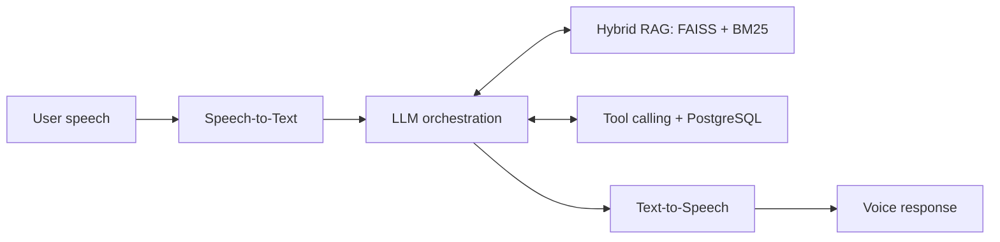

<!--
  GitHub Profile README · Orkhan Nuriyev
  SINGLE-FILE EDITION
  No local images, GIFs, assets folders, CSS, or JavaScript required.
-->

  

  <h3>Building intelligent systems, from models to real-world applications.</h3>

  

  

    
    
    
  

  
<strong>Voice AI</strong> &nbsp;•&nbsp; <strong>LLMs & RAG</strong> &nbsp;•&nbsp; <strong>AI Agents</strong> &nbsp;•&nbsp; <strong>Applied ML</strong> &nbsp;•&nbsp; <strong>AI Backend Engineering</strong>

---

### `01` &nbsp; About Me

I'm **Orkhan**, an **AI/ML Engineer** focused on building end-to-end systems that connect **machine learning, intelligent agents, speech technologies, and scalable backend services**.

I work across the full AI lifecycle: **data pipelines → model development → inference and orchestration → APIs → deployment and evaluation**. My background in **Business Analytics** helps me connect technical implementation with measurable outcomes.

- 🧠 **AI systems:** LLM orchestration, hybrid RAG, tool calling, local/cloud inference, agentic workflows.
- 🎙️ **Real-time applications:** speech-to-text, text-to-speech, WebSockets, conversational Voice AI.
- ⚙️ **ML engineering:** feature engineering, model evaluation, automated data pipelines, CI/CD, deployment.
- 📍 **Based in:** Baku, Azerbaijan.

### `02` &nbsp; Featured Projects

<table>
<tr>
<td width="50%" valign="top">

#### 🎙️ [AzVoice AI](https://github.com/orxannuriyev/AzVoice-AI)
**Real-Time Azerbaijani Voice Assistant**

An end-to-end voice AI system designed for natural Azerbaijani conversations, including hotel call-center interactions.

**Key engineering work**
- Hybrid RAG: **FAISS + BM25**
- STT → LLM → tools → TTS pipeline
- Local/cloud models with automatic fallback
- FastAPI + **WebSockets** for real-time interaction
- PostgreSQL-backed tool calling, Docker deployment
- Inference latency, quality, and cost evaluation

**Stack:** `Python` `FastAPI` `Faster-Whisper` `Ollama` `Gemini` `Groq` `FAISS` `BM25` `PostgreSQL` `Docker`

**[Explore repository →](https://github.com/orxannuriyev/AzVoice-AI)**

</td>
<td width="50%" valign="top">

#### 🌱 [QuadroSense](https://www.quadrosense.online/)
**ML-Powered Soil Moisture Forecasting**

A precision-agriculture platform forecasting soil moisture across multiple regions in Azerbaijan.

**Key engineering work**
- **14-day** soil moisture forecasts
- Region-specific **XGBoost** prediction models
- Automated ETL from **Open-Meteo** weather data
- Daily predictions and updates with **GitHub Actions**
- Interactive analytics and ML data workflows
- Reported project evaluation: **MAE < 0.05**

**Stack:** `Python` `XGBoost` `Scikit-learn` `Pandas` `DuckDB` `Open-Meteo` `GitHub Actions`

**[Visit live platform →](https://www.quadrosense.online/)**

</td>
</tr>
</table>

<b>🔍 View AzVoice AI system architecture</b>

 

*Local and cloud inference paths can be selected with fallback handling.*

### `03` &nbsp; Technical Toolkit

  

 

| Focus | Tools & Technologies |
|:--|:--|
| **LLMs & Agentic AI** | Transformers, Hugging Face, RAG, FAISS, BM25, ChromaDB, Ollama, llama.cpp, AI Agents, Multi-Agent Orchestration, Tool Calling |
| **Speech AI** | Whisper, Faster-Whisper, Silero VAD, STT, TTS, Edge TTS |
| **ML & Deep Learning** | PyTorch, Scikit-learn, XGBoost, Pandas, NumPy, SciPy, model evaluation, feature engineering |
| **Computer Vision** | CNNs, YOLOv8, U-Net, ONNX, object detection, image processing, VLMs |
| **Backend & Databases** | Python, SQL, FastAPI, REST APIs, WebSockets, PostgreSQL, MySQL, DuckDB, SQLAlchemy |
| **Development & MLOps** | Docker, Git, GitHub Actions, n8n, Postman, Jupyter, VS Code |
| **Analytics** | Power BI, Excel, Power Query, statistical analysis, dashboards |

### `04` &nbsp; Experience & Education

**Selected experience**

- **Finance Intern — 166 Global Logistics** *(2025–2026)* · Financial and operational reporting, cash-flow analysis, data validation.
- **Project Data Coordinator — Azerbaijan Centre for the Fourth Industrial Revolution** *(2025)* · Data dashboards, operational reporting, and coordination of **20,000+ Coursera licenses**.
- **Data Manager — AIESEC in Azerbaijan** *(2024)* · KPI dashboards, data quality, and operational analysis.

**Education & specialized training**

- **AI Engineering — AI Academy** *(2026–present)* · Machine Learning, Deep Learning, software engineering, and mathematics for AI.
- **Data & AI — IronHack / IDDA** *(2026)* · ML, MLOps, RAG, LLMs, AI Agents, model deployment · **Final grade: 99/100**.
- **Business Analytics — Azerbaijan State University of Economics (UNEC)** *(2023–present)* · Statistics, quantitative methods, business analytics · **Grade: 97/100**.

### `05` &nbsp; Certifications & Recognition

  
  

- 🏅 **OCI 2025 Certified Data Science Professional** — Oracle University
- 🏅 **OCI 2025 Certified AI Foundations Associate** — Oracle University
- 🎓 **“Əlaçı” Scholarship** — PASHA Holding *(2026)*
- 🎓 **Huma Quşu Scholarship** *(2025)* · **TOP15 Scholarship, UNEC** *(2025)*
- 🎓 **Red Hearts Education Scholarship** — Kapital Bank *(2023)*
- 🥇 **Gold Medal, National Geography Olympiad** · **Silver Badge for Excellence in Education** *(2023)*

### `06` &nbsp; GitHub Statistics

<h3>📊 GitHub Performance</h3>

<table>
  <tr>
    <td width="50%" align="center" valign="middle">
      
    </td>
    <td width="50%" align="center" valign="middle">
      
    </td>
  </tr>
</table>

<h3>🔥 Contribution Streak</h3>

